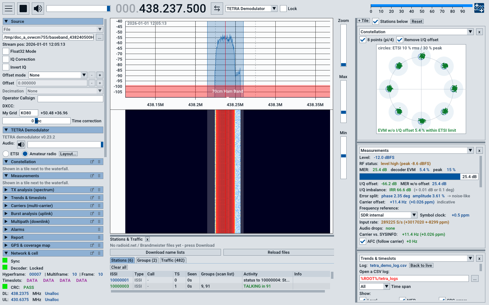
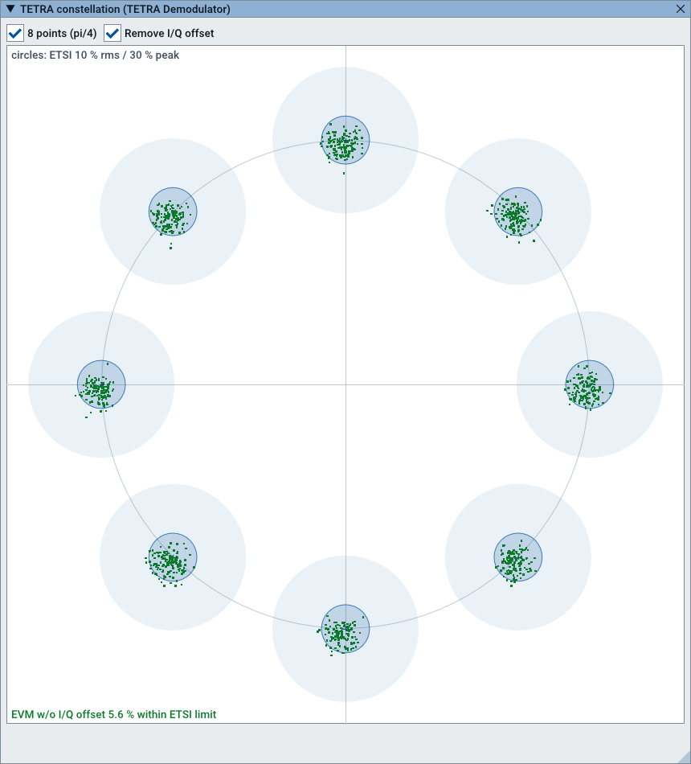
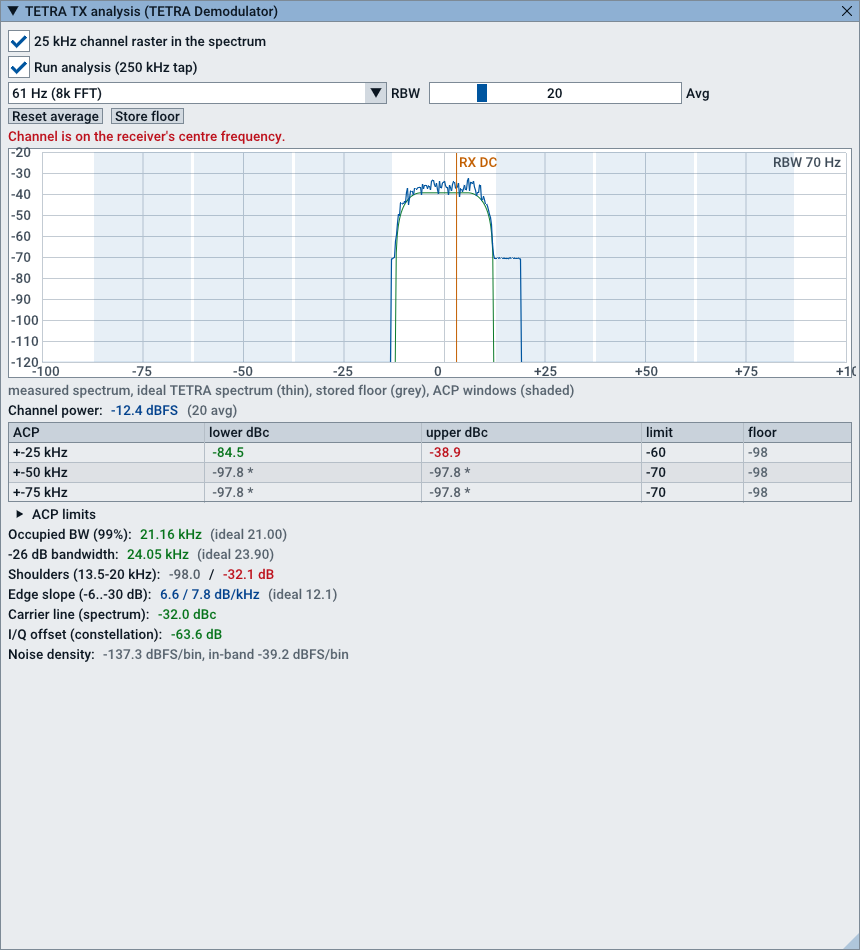
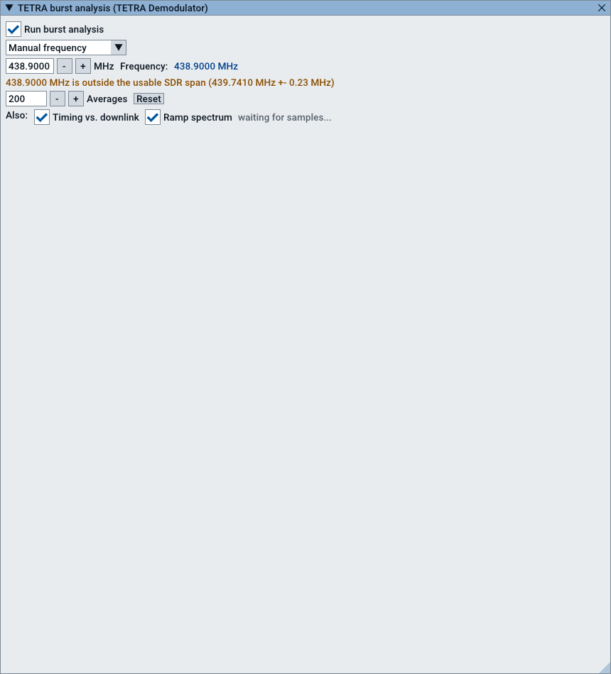
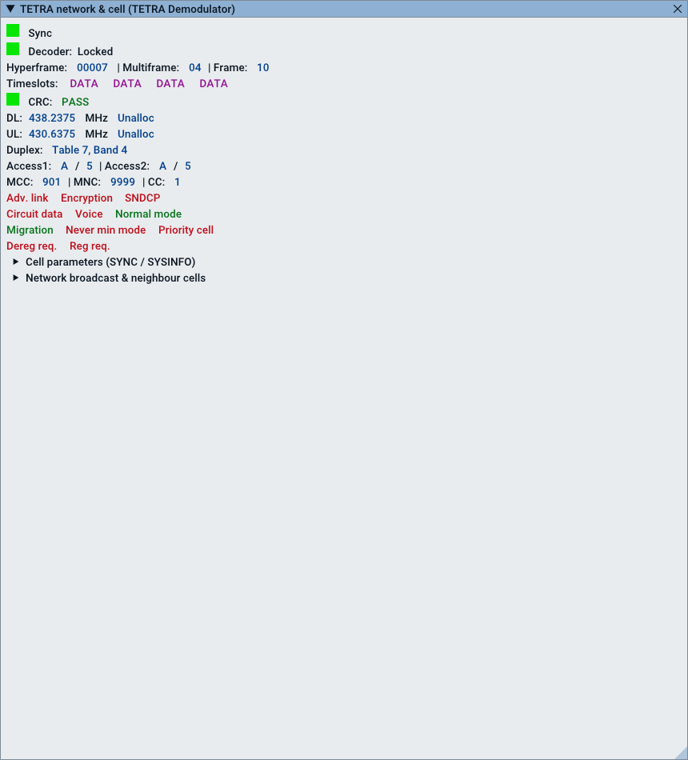
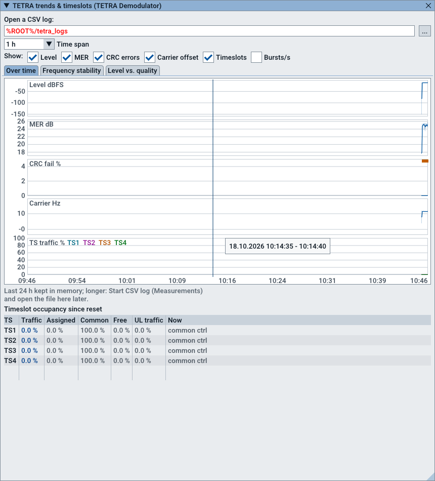
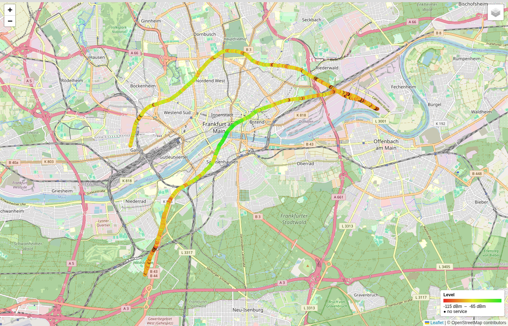

# SDR++ TETRA-SCHWARTZ

**A TETRA receiver and measurement program for amateur radio** – based on
[SDR++](https://github.com/AlexandreRouma/SDRPlusPlus) and the
[SDR++Brown](https://github.com/sannysanoff/SDRPlusPlusBrown) fork, extended
for amateur radio TETRA cells by UnImAtrIXzEr0.

> **Experimental beta.** Not an official release of SDR++ or SDR++Brown and
> not endorsed by their authors. Please report problems with this edition
> only [here](https://github.com/UnImAtrIXzEr0/sdrpp-tetra-schwartz/issues).
>
> **No support.** This is not a community project: it is a tool built and
> adapted for our own needs and published as it is, in case it is useful to
> others. We give no support or help with installation, SDRs or
> measurements. Bug reports and suggestions are welcome, but whether and when
> anything is changed is up to us alone.

[](https://github.com/UnImAtrIXzEr0/sdrpp-tetra-schwartz/releases/latest)
[](https://github.com/UnImAtrIXzEr0/sdrpp-tetra-schwartz/actions)
[](license)



*All pictures show the synthetic test cell of this repository (MCC 901, MNC 9999) – no real network.*

## What it does

- **Decoding** of TETRA downlinks (TMO): cell, network and neighbour cell
  information, calls, talkers, SDS, status, group attachments, speech audio.
  Station names from the RadioID database and talkgroup names, both on request.
- **Measurements following ETSI EN 300 394-1** (most recent editions):
  modulation accuracy (vector error, residual carrier, 200 bursts), adjacent
  channel power with the limit tables, power and time mask of bursts,
  switching transients, carrier frequency with reference selection, MER and
  decoder EVM, I/Q offset and imbalance.
- **TX analysis**: spectrum through the TETRA filter, occupied bandwidth,
  shoulders, carrier leakage, 25 kHz channel raster.
- **Burst analysis of handhelds** (uplink alone, linearity check by an
  attenuator step), **multipath** (echo delay and level from the training
  sequences), **frequency stability**, **trends**, **alarms**, **HTML report**.
- **Drive tests**: GPS, CSV log, coverage maps for Google Earth (KML) and
  OpenStreetMap, propagation diagram around the base station.
- **Your own layout**: a tile column next to the waterfall, the content of
  every tile selectable, sizes adjustable, kept across restarts; touch view
  for tablets.
- Automatic RF gain that looks for the best signal-to-noise ratio, dBm
  calibration, snap to carrier, lock VFO.
- **No decryption.** Encrypted traffic stays encrypted.

| Constellation | TX analysis | Burst analysis |
|---|---|---|
|  |  |  |

| Network & cell | Trends | Coverage map |
|---|---|---|
|  |  |  |

## Tested SDRs

Our own tests – a hint for users, not a guarantee. Other SDRs supported by
SDR++ should work as well but have not been tried with this edition.

| Device | Status | Strengths and limits for the measurements |
|---|---|---|
| **LibreSDR B220** (USRP clone, AD9361, used with UHD) | ✅ works | 12 bit, large bandwidth: uplink and downlink of a cell at the same time (≥ 12 MS/s over USB 3). Set *Master Clock* to *Auto*. High sample rates cost a lot of CPU. External reference depending on the board version. |
| **RTL-SDR V3** and **RTL-SDR V4** | ✅ works | Cheap and good for decoding, coverage drives and trends. 8-bit ADC and at most about 2.4 MS/s: limited dynamic range, so the adjacent channel limits (−60/−70 dBc) and low switching transients usually cannot be verified; MER/EVM are indicative. No external reference (the TCXO is about 1 ppm). Uplink and downlink of a cell do not fit into the bandwidth together. |
| **PLUTO+** (AD9363, ADC/DAC) | ✅ works | 12 bit, several MS/s over USB 2 or Ethernet. External 10 MHz reference input: the best choice for frequency measurements. Watch the *Overflows* counter (lost samples). |
| **HamGeek Zynq7010 AD9363 SDR** (XC7Z010CLG400 + AD9363ABCZ, Pluto-Nano clone) | ✅ works | 12 bit like the PLUTO+, compact. Frequency accuracy depends on its oscillator – calibrate it (manual, chapter 4.3). |
| **HamGeek ADI Pluto+ 70 MHz–6 GHz** (AD9363, via USB) | ❌ not yet | Connects and runs, but shows no carrier. A setting is still wrong; under investigation. |

## Download

On the [**Releases page**](https://github.com/UnImAtrIXzEr0/sdrpp-tetra-schwartz/releases/latest):

| File | For |
|---|---|
| `…_windows_x64.zip` | Windows 10 / 11 (64 bit) |
| `…_x86_64.AppImage` | Linux x86-64 (built on Ubuntu 24.04) |
| `…_Bedienungsanleitung_….pdf` | Manual, German |
| `…_User_Manual_….pdf` | Manual, English |
| `SHA256SUMS.txt` | Checksums of the downloads |

## Quick start

1. **Windows:** unpack the zip into a folder of its own and start `sdrpp.exe`.
   SDR drivers (e.g. for the USRP, PlutoSDR, RTL-SDR) as described in the manual.
   **Linux:** `chmod +x SDRPP-TETRA-SCHWARTZ_*.AppImage`, then start it
   (Ubuntu 24.04 needs `sudo apt install libfuse2t64` once for AppImages).
2. Choose your SDR under **Source** and a sample rate (2–4 MS/s is enough for
   one carrier; uplink and downlink together need more than the duplex spacing).
3. Press **Play**, click on the TETRA carrier in the spectrum (**Snap to
   carrier** puts the VFO on its centre), switch on **TETRA Demodulator**.
4. Choose **ETSI** or **Amateur radio** (own duplex tables) at the top of the
   TETRA menu, **Layout…** for a tile layout (measuring station, drive test).
5. For comparable values: **Level and hold** for the gain, a dBm calibration
   and a frequency reference – see the manual, chapter “Setting up the SDR”.

Tips:
- Hover over a value: almost every value explains itself and names its standard.
- Values marked *indicative* are not a test per the standard (e.g. over the air
  instead of at the antenna connector); the manual says what is missing.
- Drag the grip (six dots) of a section header to reorder the menu.

## Feedback

This is **not a community project and comes without support** (see above).
Bug reports and ideas are welcome and are read; there is no promise of an
answer, a fix or a new function – we decide what gets changed.

- **Bugs:** [open an issue](https://github.com/UnImAtrIXzEr0/sdrpp-tetra-schwartz/issues/new/choose)
  with version, operating system, SDR and sample rate.
- **Questions, measurement experiences, ideas:** [Discussions](https://github.com/UnImAtrIXzEr0/sdrpp-tetra-schwartz/discussions).
- Please do not post data of real networks or other people (ISSIs, names,
  positions) in screenshots or logs.
- Pull requests may be offered; whether they are taken over is decided by the maintainer.

## Legal notes

- **About the name:** “TETRA-SCHWARTZ” is a homage to the film comedy
  *Spaceballs* (Mel Brooks, 1987) – “May the Schwartz be with you”. It has no
  relation to any company, brand or product with a similar-sounding name.
- For **experimental amateur radio purposes**: receive your own or amateur
  radio cells. Listening to other radio services may be prohibited where you
  live (Germany: § 5 TDDDG).
- Origin, authors, licences and the list of changes: [NOTICE.md](NOTICE.md).
  SDR++, SDR++Brown and the TETRA plugin are GPL-3.0, the osmo-tetra decoder
  parts AGPL-3.0. The TETRA speech codec is ETSI reference code (© ETSI),
  downloaded from etsi.org during the build.
- No warranty. Measured values of an SDR are no substitute for a calibrated
  test system.

## Kurz auf Deutsch

SDR++ TETRA-SCHWARTZ ist ein TETRA-Empfangs- und Messprogramm für den
Amateurfunk (experimentelle Beta). Download für Windows und Linux sowie die
**deutsche Bedienungsanleitung (PDF)** auf der
[Releases-Seite](https://github.com/UnImAtrIXzEr0/sdrpp-tetra-schwartz/releases/latest).
Fehler bitte als [Issue](https://github.com/UnImAtrIXzEr0/sdrpp-tetra-schwartz/issues/new/choose)
melden, Fragen und Erfahrungen in den
[Discussions](https://github.com/UnImAtrIXzEr0/sdrpp-tetra-schwartz/discussions).
Keine Entschlüsselung; nur für eigene bzw. Amateurfunk-Zellen. Der Name
„TETRA-SCHWARTZ“ ist eine Hommage an die Filmkomödie *Spaceballs* (Mel
Brooks, 1987) – „Möge der Saft mit dir sein“ heißt im Original „May the
Schwartz be with you“ – und hat nichts mit ähnlich klingenden Firmen oder
Marken zu tun.

**Kein Support:** Das ist kein Community-Projekt, sondern ein Werkzeug, das
wir für unsere eigenen Ansprüche gebaut bzw. angepasst haben und so, wie es
ist, veröffentlichen. Wir leisten keine Unterstützung bei Installation, SDRs
oder Messungen. Fehlerberichte und Verbesserungsvorschläge sind willkommen –
ob und wann wir etwas davon umsetzen, behalten wir uns vor.

## Platforms and building from source

| Platform | Download | Build yourself |
|---|---|---|
| Windows 10 / 11, 64 bit | zip | possible, laborious |
| Linux x86-64 with glibc ≥ 2.39 (Ubuntu 24.04+, Debian 13, Fedora 40+, Arch) | AppImage | yes |
| Older Linux (Ubuntu 22.04, Debian 12, Mint 21), ARM boards | – | **yes** |
| macOS | – | not tested |
| Android | – | not supported |

**Step-by-step instructions** with the prerequisites for Debian/Ubuntu,
Fedora, Arch, Windows and macOS: [docs/BUILDING.md](docs/BUILDING.md).
SDR drivers come from their makers – the page links to them (RTL-SDR,
PlutoSDR, USRP/UHD, HackRF, Airspy, BladeRF, LimeSDR, SDRplay, SoapySDR).

Linux in short (Debian/Ubuntu):

```sh
sudo apt install build-essential cmake ninja-build git unzip xxd libfftw3-dev libglfw3-dev libvolk-dev \
    libzstd-dev librtaudio-dev libpulse-dev portaudio19-dev libspdlog-dev liborc-0.4-dev \
    librtlsdr-dev libhackrf-dev libairspy-dev libairspyhf-dev libiio-dev libad9361-dev
git clone https://github.com/UnImAtrIXzEr0/sdrpp-tetra-schwartz.git && cd sdrpp-tetra-schwartz
cmake -B build -G Ninja -DCMAKE_BUILD_TYPE=Release -DCMAKE_INSTALL_PREFIX=/usr -DOPT_BUILD_CH_TETRA_DEMODULATOR=ON
cmake --build build -j$(nproc) && sudo cmake --install build && sdrpp
```

If configuring stops at a missing SDR library, install it or switch its
module off (e.g. `-DOPT_BUILD_HACKRF_SOURCE=OFF`).

The original readme of SDR++Brown: [docs/README_SDRPPBROWN.md](docs/README_SDRPPBROWN.md).
